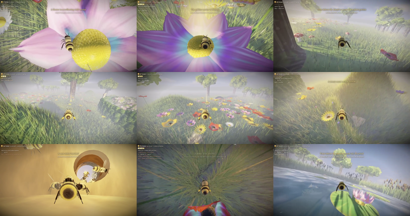

# Honeylight

**[Play it in your browser](https://blakecaldwell.net/honeylight/)**

Honeylight: a browser game where you live one short life as a honeybee. FPV-drone-style flight through a giant meadow, built with three.js. Work in progress.



## Run it locally

The game is plain HTML and JavaScript with no build step, but it uses ES modules, so it has to be served over HTTP rather than opened as a file.

```bash
python3 -m http.server 8000
```

Then open <http://localhost:8000> in a desktop browser and click to wake.

Any static file server works (for example `npx serve`).

## Run the tests

The tests run the game in a browser without a window, on any machine. They need Node 20 or newer.

```bash
npm install
npx playwright install chromium
npm test
```

They check how the game behaves and compare pictures of fixed places with reference images. See [tests/README.md](tests/README.md).

## Controls

| Key | Action |
| --- | --- |
| Mouse | Look / steer |
| W A S D | Fly or walk |
| Space / Shift | Rise / sink |
| V | Switch between bee's-eye and third-person view |
| Q / E | Dart / leap (unlocked with honey) |
| F | Heat buzz near wasps |
| R | Call your sisters |
| Tab (hold) / H | Show the keys card |

Progress is saved in your browser's local storage only.

## Files

- `index.html`, `main.js`: the game
- `three.module.min.js`: [three.js](https://threejs.org) r160, MIT licensed, vendored
- `REQUIREMENTS.md`: design requirements
- `tests/`: the tests. `package.json` only names what they need; the game itself needs no packages
- `wasp-sounds/`: a small page for auditioning wasp sound effects

## License

[MIT](LICENSE). three.js is © three.js authors, also under the MIT license.
